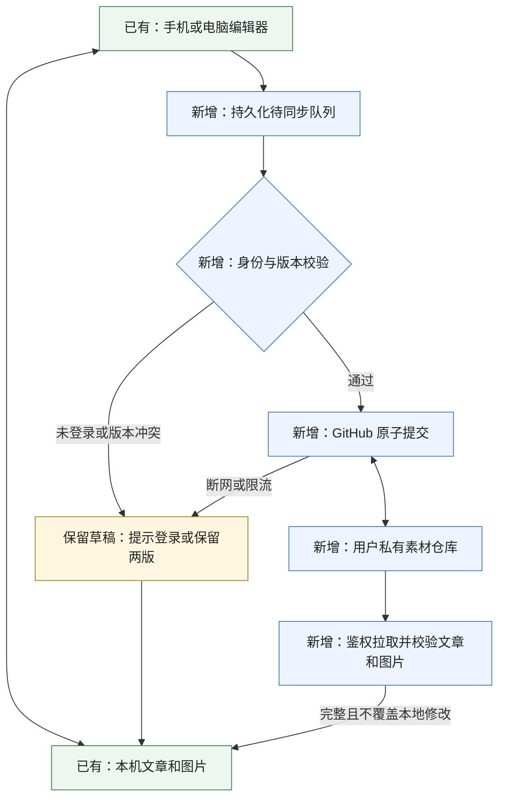

# 衍辉编辑器：iPhone 试用与 GitHub 私有同步方案

日期：2026-10-12（北京时间）

状态：用户已选择 GitHub 登录方式 A，并接受网络不可用时先本地写作、恢复连接后同步；本完整方案待审核，尚未实施或部署。

## 1. 本次要交付什么

手机和电脑使用同一个编辑器网址，通过自己的 GitHub 账号登录，接着编辑同一篇文章。文章、排版设置和本地配图存入独立私有仓库；设备上继续保留本地副本。

| 用户关心的问题     | 本次设计                                                                                               |
| ------------------ | ------------------------------------------------------------------------------------------------------ |
| 钱花在哪里         | 优先使用 GitHub 免费私有仓库和 Cloudflare Workers 免费计划，不先购买服务器或数据库；付费项目须另行确认 |
| 手机怎么使用       | Safari 直接打开，也支持添加到主屏幕；首次联网准备完成后，已下载的文章可离线编辑                        |
| 数据放在哪里       | 代码仓库与文章仓库分开；文章长期存储在用户自己的私有仓库                                               |
| 换设备会不会丢内容 | 本地保存与远端同步分别显示；同步冲突保留两份，不按设备时间直接覆盖                                     |
| 原来的编辑器怎么办 | 保留已验收的可视化编辑、专属主题、代码高亮、标题编号和导出功能                                         |

本次是单用户跨设备同步，不做多人协同。网络恢复后的重试以应用再次处于前台为准，不承诺 iPhone 锁屏后仍能持续上传。

## 2. 已有能力和缺口

以下为本次阅读代码确认的现状，不代表线上服务已经启用。

| 场景               | 现有代码                                                                  | 现状与本次处理                                                                                          |
| ------------------ | ------------------------------------------------------------------------- | ------------------------------------------------------------------------------------------------------- |
| 本机文章与图片保存 | `apps/web/src/storage/repositories/documents.ts`、`assets.ts`             | 已有 IndexedDB、图片摘要和容量校验；增加持久化待同步操作及文章版本记录                                  |
| 文章和排版备份     | `apps/web/src/services/article-bundle.ts`、`lib/visual/theme-snapshot.ts` | 已有文章、主题和图片打包及校验；复用，不将整个 ZIP 当成每次同步的数据单位                               |
| GitHub 登录        | `apps/api/src/auth.ts`                                                    | 已有 OAuth 基础，但绑定 D1 用户表，并向浏览器返回应用 JWT；私有部署需调整为单用户校验及同源 Cookie 会话 |
| 原有云同步         | `apps/web/src/services/sync/`、`stores/sync.ts`                           | 按时间戳选较新版本，不包含本地图片及完整的逐篇主题；不能直接作为本次同步协议                            |
| 离线重新打开网页   | `apps/web/vite.config.ts`、应用入口                                       | 本次检查未发现完整的网页 Service Worker 离线入口；需补应用缓存、安装状态和更新保护                      |

当前 API 默认入口还包含计费、公开分享、图床和市场路由。本次私有部署不启用这些路由，也不照搬上游的域名、数据库或存储桶配置。

## 3. 部署和权限

### 3.1 一个网址，文章不随网页公开

拟使用 Cloudflare Workers Static Assets 托管编辑器静态文件，同一个 HTTPS 来源下的 `/api/` 处理登录和同步。复用现有 Vue、Hono、Cookie/JWT 和校验工具，不引入另一套编辑器或通用存储框架。



网页程序本身允许公开访问，但未授权者不能读取文章目录、正文、私有图片或版本。这里的“私有”指文章数据访问受控，不等于把前端源代码藏起来。

部署只从干净的公开代码构建，排除本地私有示例、图片、环境文件和测试材料。不得把当前本地构建产物直接当成可公开发布的包。

### 3.2 登录和仓库写入是两份权限

日常只需在设备上点击 GitHub 登录。首次部署时，管理员还需配置一次后台访问权限，不能把这一步省略成“登录自然就能写私有仓库”。

| 授权              | 用途                 | 限制                                                                                           |
| ----------------- | -------------------- | ---------------------------------------------------------------------------------------------- |
| GitHub OAuth 登录 | 确认访问者是谁       | 仅申请身份读取，不申请所有私有仓库的 `repo` 权限；以固定 GitHub 数字账号 ID 校验唯一用户       |
| 细粒度仓库令牌    | 后台读写素材         | 只允许访问指定私有素材仓库的 Contents 读写；设定有效期，到期只在后台更新，不在每台设备重复配置 |
| 应用会话          | 浏览器访问自己的后台 | 同源、Secure、HttpOnly、SameSite=Lax Cookie，建议 7 天有效；过期暂停同步，保留本地草稿         |

GitHub OAuth 密钥、仓库令牌及会话签名密钥只放 Worker Secrets。不会出现在浏览器存储、网页构建文件、文章、备份包或日志中。GitHub 用户访问令牌仅用于登录时查询身份，不交给前端。

OAuth 回调验证短期 state 和固定回跳地址；所有写接口验证同源 Origin 和 CSRF 防护。仓库、分支、用户 ID 均由服务端配置，客户端不能指定任意仓库或代理任意 URL。资产读取同样要求登录，禁止将私有图片改成公开图床链接。

单用户会话不建立 D1 用户库。紧急撤销会话可轮换签名密钥；普通退出清 Cookie、停止同步，不默认删除未同步内容。界面明确本机副本仍保留，并提供经确认后的本机数据清理。离线保留意味着这是个人设备工具，不承诺共享设备上的本机数据加密隔离。

Cloudflare 会处理同步请求，GitHub 会保存数据；这是私有访问控制方案，不是端到端加密方案。初次配置不要求用户在聊天里粘贴任何密钥。

### 3.3 成本和网络边界

Cloudflare 免费计划当前列出每日 100,000 次请求及每次 10ms CPU 限制。个人低频同步是免费运行的候选场景，但图片校验、签名和序列化必须实测，不能仅凭请求数断言够用。保持免费计划，超限应报错并保留待同步内容，不自动升级付费。[官方价格](https://developers.cloudflare.com/workers/platform/pricing/)

优先试用平台提供的 HTTPS 地址，不先购买域名。试用须覆盖用户实际 Wi-Fi 和蜂窝网络；若首次打开或登录不可用，离线功能无法解决这个问题，需停在网络验收阶段重新确认部署入口。用户接受暂时同步失败，不等于已经接受长期打不开工具。

GitHub 普通仓库不是无限网盘。配图复用现有哈希去重，不存视频、构建产物或生成的 HTML。保留单图 10MiB 的现有产品限制；不静默压缩、重编码用户原图。大图给出体积提示，历史中的旧图片仍占仓库空间，容量治理或迁移另行确认。[GitHub 仓库限制](https://docs.github.com/en/repositories/creating-and-managing-repositories/repository-limits)

## 4. 数据和同步规则

### 4.1 数据保持可读、可导出

私有仓库建议名为 `yanhui-articles`，部署前确认可用性。公开代码仓库继续独立维护，私有仓库不启用 Pages 或自动发布工作流。

```text
catalog.json
articles/<article-id>/article.md
articles/<article-id>/meta.json
assets/<sha256>.<ext>
```

`catalog.json` 包含格式版本和轻量文章目录，用于检索标题、目录关系、当前版本和删除标记；不重复保存正文。

`article.md` 保留编辑器输出的 Markdown，不把渲染出来的序号、HTML 或临时图片地址写回文章。`meta.json` 保存标题、目录关系、创建及修改时间、文章版本、正文/主题摘要、完整主题快照、引用图片清单和最近操作标识。图片清单保留大小、类型、SHA-256 与 GitHub 对象标识，二者不可混用。

每篇文章同步其有效主题，包括字号、行距、标题、强调色、代码样式、表格及图片在正文里的尺寸和对齐信息。设备布局、登录状态、AI 密钥和发布密钥不进入文章同步数据。不同设备的全局默认设置暂不互相覆盖。

外链图片保持外链并标明依赖外部来源；本次不自动抓取第三方资源，也不承诺外链图片离线可用。缺失的本地配图必须提示，不把不完整版本标成完整同步。

### 4.2 本地保存与远端确认分开

| 状态             | 明确含义                                                                 |
| ---------------- | ------------------------------------------------------------------------ |
| 已存本机，待同步 | 正文及待同步记录已持久化，还未得到远端确认                               |
| 同步中           | 正在上传或下载这次固定版本，写作仍可继续                                 |
| 已同步           | 当前文章正文、主题、引用的本地图片已完整确认；没有更新的本地修改等待发送 |
| 需处理           | 版本冲突、授权失效、数据损坏或容量限制；提供对应动作，不显示虚假的成功   |

文字落库与待同步标记使用同一 IndexedDB 事务；队列不能只存在于内存。复用现有编辑器 flush，在中文输入法组合尚未提交时不截断文字、不强制重载。

首轮建议停笔 30 秒后尝试同步；每台设备自动提交最多每分钟一次，也有“立即同步”。重新打开、回到前台及恢复网络时检查待同步任务；读请求使用版本/ETag，避免无变化时反复下载。网络错误指数退避，遵守服务端限流等待时间，不无限紧密重试。

网页关闭、锁屏或系统结束进程时不依赖最后一次上传。只承诺已成功本地保存的内容可以在本机恢复，不承诺系统杀进程前最后一个尚未落库的按键绝不丢失。

### 4.3 一次完整文章更新，对远端原子可见

一个文章版本包含正文、主题、元数据和所需图片。先创建缺少的 Git blobs，再基于已读取的树构造新树和提交，最后以 `force=false` 更新目标分支；目录与文章文件在同一次提交中变化。上传中途失败时，不推进分支，也不显示同步完成。[Git trees](https://docs.github.com/en/rest/git/trees#create-a-tree)、[Git references](https://docs.github.com/en/rest/git/refs#update-a-reference)

请求携带文章 `baseRevision` 和稳定的操作 ID。后台先检查当前文章版本，再以当前分支头为父提交；提交竞争后重新读取，不把旧整棵树强行覆盖。不同文章的并发修改可重新构造提交后重试，同一文章的版本变化返回冲突。时间戳只用于显示，不用于判断谁应该覆盖谁。

对一次超时请求，客户端沿用同一操作 ID。若远端当前版本已对应同一操作及同一内容，直接确认成功；若远端后来又被编辑，走版本冲突流程，不能为重试覆盖新内容。

上传期间继续输入会形成新的本地版本。旧请求的响应只能确认旧版本，不能清掉新版本的待同步状态。

拉取固定提交下的文章和图片，校验格式、摘要、主题及图片后，事务性应用到本地。网络中断或校验失败不推进该文章的已下载版本，也不覆盖旧副本。文章列表可先显示远端目录，但未下载文章不标为可离线编辑。

### 4.4 冲突、删除和恢复

| 情况                           | 处理方式                                                                                               |
| ------------------------------ | ------------------------------------------------------------------------------------------------------ |
| 两端从同一旧版本修改同一篇     | 本地和远端均保留，展示差异；“使用本机版本”“使用远端版本”“另存为新文章”都先留恢复副本，不做正文自动合并 |
| 一端删除，另一端仍有修改       | 作为冲突处理，不直接丢弃修改；目录里的版本化删除标记防止旧设备把文章悄悄复活                           |
| 单纯删除或恢复文章             | 删除在回收站保留，恢复通过新提交完成；本次不自动清理历史、图片或强制重写 Git 历史                      |
| 远端文件遭手动修改、格式不兼容 | 按 Git 文件变动识别新版本；若内容与目录/元数据不一致，停止应用并提示修复，不覆盖本机内容               |
| 登录过期、令牌过期、仓库失联   | 停止远端操作，保留本机与队列；分别提示重新登录、更新后台授权或稍后重试                                 |

后台每次写入同时验证正文/主题的实际摘要与版本元数据，不能只相信 `meta.json` 中未变化的 revision，以免遗漏绕过工具的手动提交。

首次连接先显示远端目录，再让用户选择哪些本地文章要上传；不自动把所有历史文章、私有示例或公司材料上传。已有本地 ID 与远端 ID 冲突时先比较内容，不默认覆盖。可先用现有 ZIP 导出保留独立备份。

Git 历史有助于恢复，但不替代独立备份。继续提供现有 ZIP 导出和恢复；恢复为新文章，不覆盖当前文章。历史版本恢复也通过新提交完成，不回退整个仓库分支。

## 5. iPhone 离线和安全边界

离线能力在首次成功联网并完成缓存后生效。增加网页清单、头像风格图标和有版本的 Service Worker；复用已有依赖，只有现有工具不足以可靠生成缓存清单时才考虑新增依赖。

应用缓存只保存自身静态代码、字体和编辑所需模块。文章及私有图片仍放当前设备的 IndexedDB；`/api/`、OAuth 回调、登录页响应不进入公共缓存或 Service Worker 通用缓存。私有响应使用 `Cache-Control: no-store`。代码/公式/Mermaid 的离线依赖准备完成后才宣称可离线使用，未准备完成时不能把空白图形当成正常预览。

新版本等待用户完成本地保存并确认后再激活，不在写作或中文输入时自动刷新。数据库只做兼容性迁移，升级不能清空原有文章。离线编辑和在线预览继续走现有 HTML 净化及主题 CSS 校验；同步内容不是可信代码。

请求浏览器持久存储并处理被拒绝、空间不足和 IndexedDB 不可用的情况。降级到旧存储时，明确图片/同步能力受限，不宣称仍有完整保护。浏览器仍可能清理数据；新设备首次打开、未下载文章和未同步草稿都不能凭空离线恢复。[WebKit 存储政策](https://webkit.org/blog/14403/updates-to-storage-policy/)

Safari 与主屏幕入口分别验证，不假定它们共享缓存或登录状态。微信内置浏览器暂不作为完整编辑的验收入口；可以引导用 Safari 打开，不能借此宣称微信粘贴已经验证。

## 6. 改动范围与失败检查

| 改动位置                          | 必须覆盖的调用方、数据和检查                                                                                |
| --------------------------------- | ----------------------------------------------------------------------------------------------------------- |
| `apps/api` 私有入口及独立部署配置 | 复用 Hono/OAuth 处理，新增单用户鉴权、Cookie 会话和 GitHub 数据读写；不连接上游 D1/R2、图床、计费或公开分享 |
| `apps/web` 账户与同步服务/状态    | 接通私有同源接口，替换此部署下的时间戳覆盖策略；原有独立本地编辑继续可用，不额外启用上游同步                |
| 本地存储及文章快照                | 文章、主题、资源、待发送操作与确认版本相互一致；复用现有图片、备份校验，覆盖容量失败和遗留存储降级          |
| 移动界面与离线入口                | 沿用现有组件，补状态、冲突处理及主屏幕支持；维护简中、繁中、英文、日文四套文案                              |
| 测试和交付文档                    | 契约/并发/安全/断网测试、桌面与 WebKit 自动化、iPhone 人工检查、迁移备份和停止同步操作说明                  |

后端只接受固定仓库内允许的文章、索引和资源路径。限制请求大小、路径、资源数量、类型、摘要和格式版本；图片上传复用客户端完整解码校验，服务端独立检查类型签名、大小及摘要，不能只信客户端声明。后台不能直接复用依赖 DOM 的主题验证，需使用适合运行环境的结构/资源限制；浏览器在应用远端样式前再做现有完整 CSS 校验。

日志只记录请求标识、状态、耗时和错误类型，不记录正文、图片、访问令牌或 Cookie。非本人登录拒绝访问；陌生账号、伪造来源、目录穿越、超限上传和恶意 HTML/CSS 不得读取数据或破坏已有文章。

## 7. 怎样算验收通过

### 7.1 自动检查

| 场景                           | 必须满足的结果                                                           |
| ------------------------------ | ------------------------------------------------------------------------ |
| 电脑写文章、手机接着改         | 正文、专属样式、表格、代码、Mermaid 和本地图片一致；再回电脑不丢修改     |
| 断网、超时、重复提交、接口限流 | 本机草稿保持可编辑；重试不重复建文章，不把失败显示为已同步               |
| 并发编辑及删除冲突             | 同篇修改保留两版，不同篇更新均可成功；旧设备不能复活已删文章或覆盖新版本 |
| 图片失败或恶意输入             | 中断不产生可见的半篇远端版本；缺图、摘要不匹配和危险内容均有明确提示     |
| 升级、退出和旧版本恢复         | 不清空未同步文章，不泄漏私有数据，不回滚其他文章；独立备份可恢复         |

保留现有编辑/导出回归，新增 GitHub mock 契约测试，并在经批准的私有测试仓库验证真实 API 竞争行为。模拟器或桌面 WebKit 的成功不能替代 iPhone 实测。

### 7.2 iPhone 由用户完成一次约 15 分钟试用

1. Safari 登录、打开测试文章、添加到主屏幕；Wi-Fi 与蜂窝网络分别检查打开和登录。
2. 输入一段中文，修改列表/表格/代码，插入一张照片；检查键盘、工具条、选区、撤销及横竖屏遮挡。
3. 飞行模式下继续编辑已下载文章，回到主屏幕后重新打开；恢复网络并回到前台，确认待同步内容发出。
4. 电脑和手机故意分别修改同一篇，验证两份修改都能找到；再测试一端删除、另一端继续写。
5. 手机导出 MD、HTML 和文章图片 ZIP，完成一次恢复；复制及分享能力按真实可用情况记录，不推定等同于桌面微信后台。

第一轮使用测试文章或用户明确选择的副本，不用未授权的公司材料。记录实际 iOS 版本、Safari/主屏幕入口及失败截图，按实际设备修复，而非只按屏幕宽度判断通过。

## 8. 上线、撤回与范围限制

顺序是：本方案审核、实施计划审核、本地开发测试、用户确认外部资源与首次上传范围、私有试用、iPhone 验收，再决定日常启用。选择方式 A 不等于授权现在创建云资源或上传全部本机文章。

首次外部配置需要用户自己的 Cloudflare 账号、GitHub OAuth App、独立私有仓库及单仓库授权。部署配置使用独立名称，不修改或覆盖现有上游资源。默认先手动发布经过验证的代码版本；不把每次 push 自动上线与这次同步混在一起。

出现问题时先停用同步，保留本地队列、原草稿及远端历史，再撤销后台仓库令牌。前端版本可回退到与当前本地数据格式兼容的已验证版本；禁止自动降级数据库或重置仓库。迁移正式域名前，先导出仍未同步的本机副本，不能假设换网址后浏览器存储还在。

本次不做公众号自动发布/草稿接口、飞书双向同步、多人协作、自动合并正文、视频存储、图片生成、自动清理 Git 历史或 VS Code 插件。现有导出保留；公众号草稿接入作为后续单独审核的功能。

## 9. 资料与审核结论

技术依据以 2026-10-12 本地代码和当日官方文档为准。未进行任何云端写入或 iPhone 真机验证。

GitHub 免费私有仓库与 Pages 权限边界见 [GitHub plans](https://docs.github.com/en/get-started/learning-about-github/githubs-plans)；单仓库细粒度授权见 [Personal access tokens](https://docs.github.com/en/authentication/keeping-your-account-and-data-secure/managing-your-personal-access-tokens)；身份登录流程见 [OAuth apps](https://docs.github.com/en/apps/oauth-apps/building-oauth-apps/authorizing-oauth-apps)；同源静态页面加后台入口见 [Workers Static Assets](https://developers.cloudflare.com/workers/static-assets/)。

自检重点：没有把公开代码当成私有文章备份，没有把本机保存当成云端成功，没有把登录身份权限当成仓库写权限，没有把离线能力当成首次访问保证，也没有把方案认可写成已部署完成。

请审核本方案。通过后再拆解实施计划；尚不开始产品代码开发。
